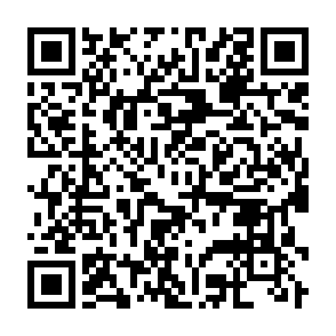
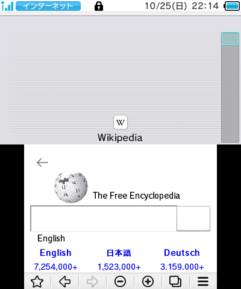
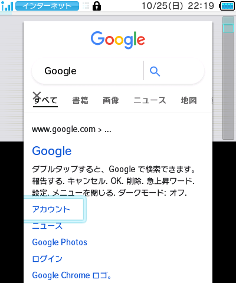
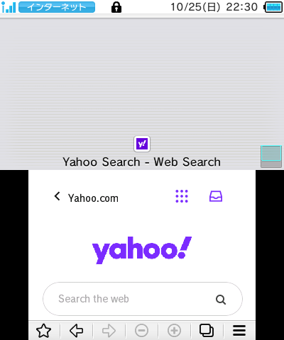

# SKATER+

[日本語](README.ja.md)

> [!CAUTION]
> **Most of this project's code and documentation was created with generative
> AI assistance.** JPN has been tested on real hardware, but users should review
> the source and generated files with that disclosure in mind. Other regions
> remain experimental.

Compatibility patch for the **New Nintendo 3DS Internet Browser (SKATER)**.
It adds modern TLS 1.2 support, current root certificates, website fixes, and
a Japanese first-run registration fix.

Luma3DS applies the patch from the SD card at launch.

## Download

- [CIA](https://github.com/shima0625/SKATER-plus/releases/latest/download/skater-plus-patcher.cia)
- [3DSX](https://github.com/shima0625/SKATER-plus/releases/latest/download/skater-plus-patcher.3dsx)

<a href="https://github.com/shima0625/SKATER-plus/releases/latest/download/skater-plus-patcher.cia"></a>

## Features

- TLS 1.2 with ECDHE-RSA/ECDHE-ECDSA AES-GCM.
- P-256/P-384 certificate and handshake-signature verification.
- [25 additional root certificates](docs/CERTIFICATES.md).
- Import your own root certificates from SD with the patcher.
- iOS 7-era mobile Safari user agent and HTTPS Google search.
- Official JPN first-run setup fix.

Google search currently requires signing in. The stock iOS 6 user agent is
rejected; the patched iOS 7-era user agent works in the tested signed-in path.

## How it works

```text
SKATER launch
  -> code.ips changes file names, UA, Google URL, and JPN first-run logic
  -> Luma loads os2.cro.lex instead of the stock OpenSSL CRO
  -> tlsfix.crr authorizes the redirected CRO identity
  -> patched CRO sends a modern TLS 1.2 ClientHello and performs ECDHE
  -> certificate bridge verifies P-256/P-384 chains
  -> updated rootca.pem supplies current trust anchors
```

SKATER's bundled OpenSSL 1.0.2 still handles transport, TLS state, and ordinary
certificate validation. Mbed TLS supplies only the EC public-key parsing and
P-256/P-384 ECDSA operations missing from that build. This preserves SKATER's
existing TLS path and ABI instead of replacing the whole stack.

Four existing cipher-table records are repurposed for ECDHE. That makes the
table non-monotonic, so only the cipher-ID lookup changes from binary search to
a bounded linear scan of at most 71 records. The worst-case comparison count
increases, but this is a small fixed table and not a bulk-data path. Cipher IDs
are public, so position-dependent lookup time does not expose secret material.

The JPN first-run fix still uses Nintendo's official `sec.ifilter.jp` service.
It uses HTTP because the stock system registration client cannot negotiate the
current HTTPS endpoint. The one-time device identifier and response are not
encrypted, so use a trusted network.

## TLS 1.3

TLS 1.3 is not a practical incremental extension of this patch. SKATER's
bundled OpenSSL code implements the older TLS state machine. TLS 1.3 changes ClientHello,
key scheduling, handshake messages, transcript handling, and record keys.
Adding it would mean replacing most of the TLS transport with OpenSSL 1.1.1+
or a newer Mbed TLS stack, then integrating that stack with SKATER's socket,
memory, threading, and certificate interfaces.

The current work already expands the CRO and hooks functions, cipher records,
ECDHE, and certificate handling, but it preserves the old state machine and
ABI. TLS 1.3 would replace that foundation and reconnect a newer stack to
SKATER's sockets, allocator, threads, CRO ABI, and certificate UI. It is a
separate project with substantial RAM, code-size, and stability risk.
Improving TLS 1.2 coverage is the realistic scope of SKATER+.
See the official [OpenSSL TLS documentation](https://docs.openssl.org/1.1.1/man7/ssl/)
and [Mbed TLS TLS 1.3 architecture](https://github.com/Mbed-TLS/mbedtls/blob/development/docs/architecture/tls13-support.md).

## Compatibility

| Region | Luma title folder | Status |
| --- | --- | --- |
| JPN | `0004003000008802` | Real hardware: first-run, Wikipedia, Google, Yahoo, certificates and mobile UA confirmed |
| USA | `0004003000009402` | Launch/UA confirmed in Azahar; TLS needs real hardware |
| KOR | `000400300000AE02` | Launch/UA confirmed in Azahar; TLS needs real hardware |
| EUR/AUS | `0004003000009D02` | Launch/UA confirmed in Azahar; TLS needs real hardware |

China/Taiwan and Old Nintendo 3DS SPIDER are outside this project's scope.
See [the full test record](docs/COMPATIBILITY.md).

## Install

Requirements: a New Nintendo 3DS-family system, the latest regional browser
update, and an up-to-date Luma3DS release.

1. Boot while holding <kbd>Select</kbd>, enable **Enable game patching**, and
   save with <kbd>Start</kbd>. The patcher also checks this setting at startup.
2. Launch `skater-plus-patcher.cia` from HOME Menu, or
   `skater-plus-patcher.3dsx` from Homebrew Launcher.
3. Press <kbd>A</kbd>. The patcher detects JPN, USA, EUR/AUS, or KOR, reads
   the official browser files, verifies them, and builds the Luma patch on SD.
4. CIA users can choose whether to keep or uninstall the patcher. Exit normally
   when using the 3DSX build.
5. Launch the browser and test the sites you want to use.

Launch the patcher again and choose **Remove patch** to delete SKATER+ files.
A reboot is not required after removal. If matching paths already contain
other files, the patcher keeps backup copies but does not restore them
automatically.

Press <kbd>X</kbd> to uninstall the patcher CIA at any time, including before
installing the patch and from an error screen.

To add a root certificate, place one PEM certificate per `.pem` or `.crt` file
in `sd:/3ds/skater-plus-patcher/certs/`. Launch the patcher with the patch
installed, press <kbd>Y</kbd>, and confirm each root's subject and SHA-256
fingerprint. See [Certificates](docs/CERTIFICATES.md#adding-your-own-roots).
Press <kbd>L</kbd> to select and remove an imported root certificate.

## Screenshots

| Wikipedia | Google | Yahoo.com |
| --- | --- | --- |
|  |  |  |

## Building

Building the patcher uses the included runtime assets. Regenerating the browser
patches requires personally dumped browser files. See [BUILDING](docs/BUILDING.md),
[CERTIFICATES](docs/CERTIFICATES.md).

## Limitations

- Only JPN has completed real-hardware testing.
- Modern JavaScript, HTML/CSS, codecs, or unsupported TLS features can still
  prevent a site from working.
- Google behavior is server-controlled and can change.

When reporting a result, include console region/model, system and Luma
versions, title ID, URL, error code, and whether the site works unpatched.
Never upload browser dumps.

## Credits and license

Thanks to Luma3DS, OpenSSL, Mbed TLS, micro-ecc, and the 3DS reverse-engineering
community. Original code is MIT licensed. Third-party terms are listed in
[THIRD_PARTY_NOTICES.md](THIRD_PARTY_NOTICES.md). No listed project endorses
SKATER+.
